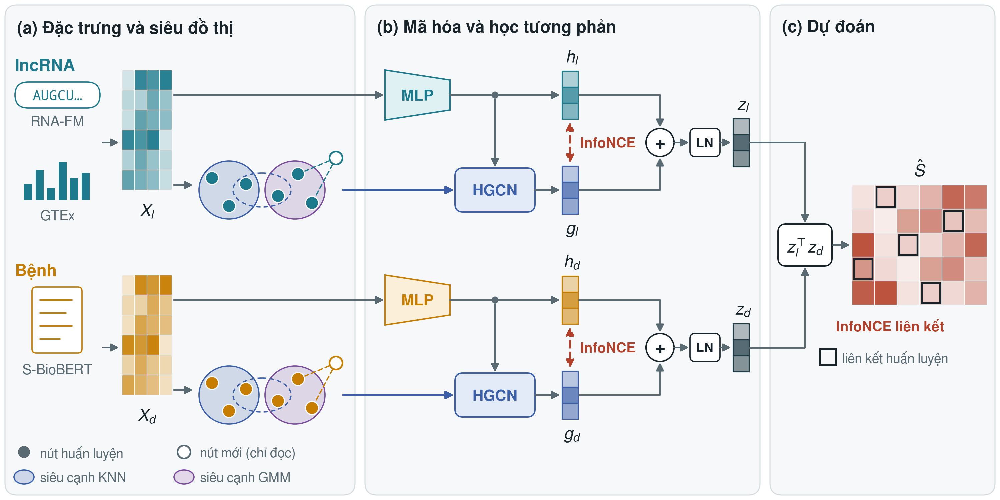
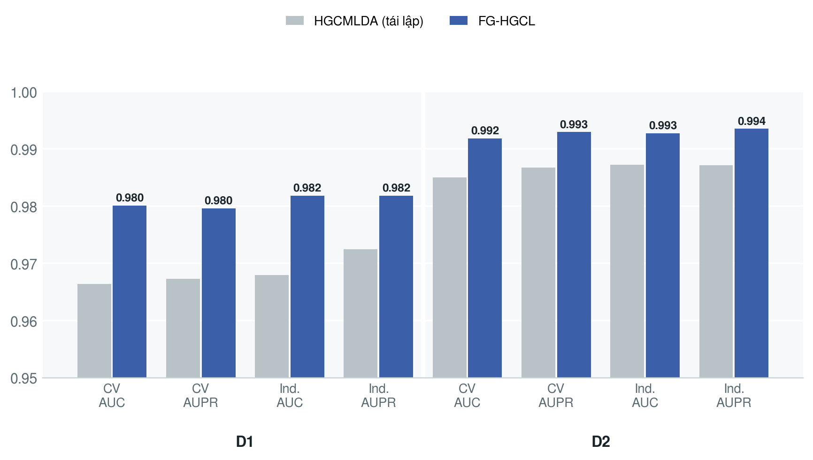
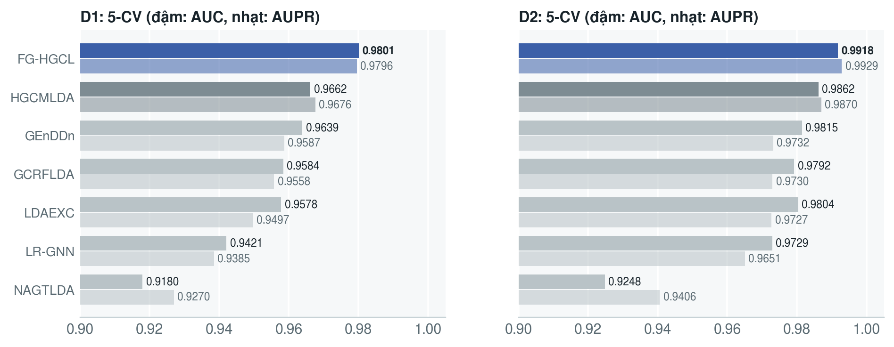
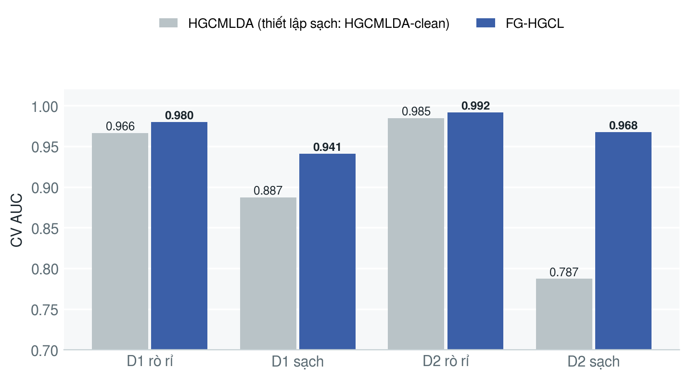
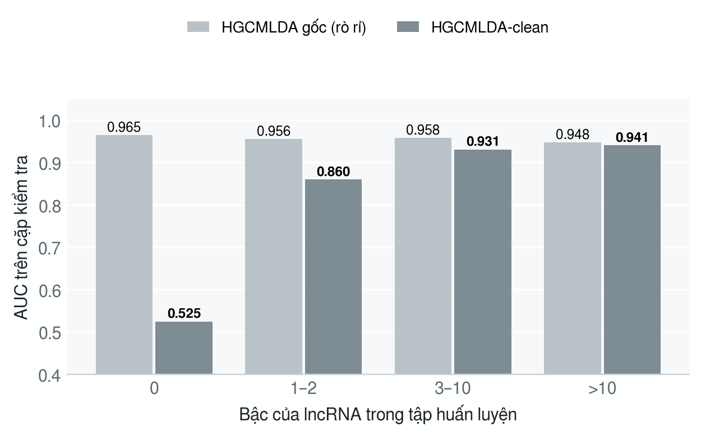
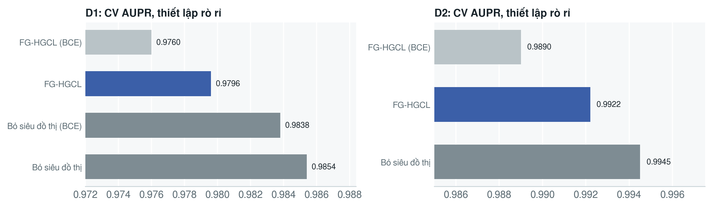

# FG-HGCL: Feature-Grounded Hypergraph Contrastive Learning for lncRNA–Disease Association Prediction

## Motivation

Known lncRNA–disease associations are sparse (about 1–2 % of all pairs), and the most useful predictions are for
lncRNAs or diseases that have **no known association yet** (cold-start). Existing methods tend to fall into one of two
groups:

- **Hypergraph contrastive models** such as HGCMLDA build every node input from the association matrix (GIPK, LFS).
  When these inputs are computed on the full matrix they include test links (the HGCMLDA authors report a no-leak
  check in their supplementary material), and they are empty for a new node.
- **Content models** such as CDELDA encode sequence and text features. They generalise to new nodes, but they encode
  each node independently and ignore structure.

FG-HGCL keeps hypergraph contrastive learning but anchors it to label-free content features and builds every
structure inductively, so the same model scores warm and cold-start pairs without label leakage.

## Method



- **Feature towers:** two-layer MLPs on fixed, label-free content features (lncRNA: RNA-FM ‖ GTEx; disease: frozen
  S-BioBERT text embeddings, on D2 with name / definition / synonym views). No input is derived from the association
  matrix.
- **Strict-inductive hypergraphs:** KNN (cosine) and GMM hyperedges built from training nodes only, propagated by an
  HGCN. Under Protocol A a node outside training reads from training nodes and never changes their embeddings.
- **Two-level contrastive learning:** InfoNCE between the feature embedding `h` and the hypergraph embedding `g` of each
  node (λ 0.5, τ 0.2), fused as `z = LN(h + g)` and scored by a dot product; the link loss is InfoNCE with K = 64
  negatives (D2: InfoNCE + BCE).
- **Leakage control:** epochs and configurations are chosen on an inner validation split carved from the training
  pairs of each fold. `tests/test_leakage.py` (21 cases) checks that scores do not depend on labels outside the
  training block.

## Evaluation

HGCMLDA's original protocol on its two datasets (`scripts/hgcmlda_protocol.py`): an independent split plus 5-fold CV
over pairs, 1:1 negatives, paper-style AUC / AUPR, and the same splits as the reproduction of HGCMLDA.

- **Leaky setting:** the protocol as published. FG-HGCL additionally receives HGCMLDA's IL / ID similarities computed
  on the full association matrix (`fghgcl/leaky.py`), so both models see the same inputs.
- **Clean setting:** similarities and hypergraphs use training links only. HGCMLDA-clean is the released HGCMLDA code
  with IL / ID recomputed per fold from training links (both fold-test and independent links removed).
- FG-HGCL results are means over 3 model seeds; HGCMLDA reproductions over 3–5 seeds. Paired comparisons use the same
  test pairs per fold and a corrected resampled t-test.

## Results

All numbers below are produced from the JSON files in `results/hgcmlda_protocol/`.

### Leaky setting (HGCMLDA's benchmark)

| Dataset | Model | CV AUC | CV AUPR | Ind. AUC | Ind. AUPR |
|---|---|---|---|---|---|
| D1 | HGCMLDA (paper) | 0.9662 | 0.9676 | 0.9648 | 0.9642 |
| D1 | HGCMLDA (reproduced, 5 seeds) | 0.9664 | 0.9673 | 0.9679 | 0.9724 |
| D1 | **FG-HGCL** | **0.9801** | **0.9796** | **0.9818** | **0.9818** |
| D2 | HGCMLDA (paper) | 0.9862 | 0.9870 | 0.9847 | 0.9849 |
| D2 | HGCMLDA (reproduced, 3 seeds) | 0.9850 | 0.9867 | 0.9872 | 0.9871 |
| D2 | **FG-HGCL** | **0.9918** | **0.9929** | **0.9927** | **0.9935** |

FG-HGCL wins 5/5 folds against the reproduction on the same test pairs (CV AUC +0.014, p = 0.038 on D1; +0.007,
p = 0.002 on D2), and the advantage holds on two fresh 5-CV splits that were not used for any choice.





### Clean setting

The HGCMLDA authors report a no-leak check in their supplementary Tables S2 and S3 (similarities recomputed without
the test links of each fold). The table compares against those numbers and against HGCMLDA-clean, the stricter
recomputation run here.

| Dataset | Model | CV AUC | CV AUPR |
|---|---|---|---|
| D1 | HGCMLDA, authors' no-leak check (Tables S2, S3) | 0.9313 | 0.9362 |
| D1 | HGCMLDA-clean (5 seeds) | 0.8873 | 0.9043 |
| D1 | Popularity ranker (no learning) | 0.9300 | 0.9398 |
| D1 | **FG-HGCL** | **0.9413** | 0.9222 |
| D1 | FG-HGCL, collaborative-signal hypergraph | 0.9460 | 0.9349 |
| D2 | HGCMLDA, authors' no-leak check (Tables S2, S3) | 0.9463 | 0.9417 |
| D2 | HGCMLDA-clean (5 seeds) | 0.7873 | 0.8489 |
| D2 | Popularity ranker (no learning) | 0.9524 | 0.9571 |
| D2 | **FG-HGCL** | **0.9675** | **0.9679** |
| D2 | FG-HGCL, collaborative-signal hypergraph | 0.9694 | 0.9695 |

Against the authors' no-leak numbers FG-HGCL is higher in CV AUC on both datasets (+0.010, +0.021) and in CV AUPR on
D2 (+0.026), and lower in CV AUPR on D1 (−0.014). These are mean-only comparisons, since per-fold numbers are not
published. Against HGCMLDA-clean on the same test pairs, FG-HGCL is higher on all four metrics and wins 5/5 folds
(+0.054 and +0.180 CV AUC). The HGCMLDA-clean drop concentrates on lncRNAs without training links:





### Where the gain comes from

- Content features in place of association-derived inputs account for most of the gap in the clean setting.
- InfoNCE as the link loss adds +0.003 to +0.004 CV AUPR over BCE.
- On D1, D2 (warm), removing the KNN + GMM hypergraph and the `h ↔ g` contrast gives equal or higher scores: the
  hypergraph propagates the tower's own embedding and adds no information. Association-hypergraph views, external
  knowledge hyperedges (miRNA, locus, MeSH) and contrastive-loss swaps inside HGCMLDA did not help either.
- Keeping the content hyperedges but propagating neighbours' training link profiles (`hg_signal links`, λ 0.1) helps in
  the clean setting on D1 (CV AUC 0.946 vs 0.942 without the hypergraph, 5/5 folds, p = 0.008), is on par on D2 and
  does not help in the leaky setting. Most of the gain comes from the propagated signal; the contrastive term adds
  0.0007 AUC.
- A popularity ranker reaches 0.930 / 0.952 CV AUC, so the 1:1 warm benchmark leaves little room above it.



## Repository layout

| Path | Content |
|---|---|
| `fghgcl/model.py`, `fghgcl/hypergraph.py` | Model, losses (incl. the collaborative-signal option `hg_signal`), KNN/GMM hypergraphs, Protocol A/B propagators |
| `fghgcl/harness.py` | Training loop, inner split, adapter for CDELDA's evaluation harness |
| `fghgcl/leaky.py` | HGCMLDA-style similarities on the full matrix (leaky setting only) |
| `fghgcl/chain.py` | Modular re-implementation of HGCMLDA and the HGCMLDA → FG-HGCL module-replacement chain |
| `configs/` | Every configuration tried (`fg_hgcl_both_cold.yaml`), the module chain, baselines |
| `scripts/` | Data building, HGCMLDA-protocol runs, analyses, run queues (`queue_*.sh`) |
| `data/harness/data_rd_{D1,D2,l2d5}/` | Inputs: association matrix, lncRNA features, disease embeddings, DSS, KG hyperedges |
| `data/splits/` | Fold and inner-validation split manifests |
| `results/` | JSON summaries of every run (per-fold metrics, chosen epochs, configurations) |
| `figures/` | Figures shown in this README |
| `tests/` | Leakage tests |

## Setup

Python ≥ 3.12 with `torch`, `numpy`, `scipy`, `scikit-learn`, `pyyaml`, `pytest` (`transformers` only to rebuild disease
embeddings). A CUDA GPU is recommended but not required for the tests.

```bash
python -m pytest -q tests/          # 21 leakage tests

# FG-HGCL on D1 (clean / leaky)
python scripts/hgcmlda_protocol.py --dataset 1 --variant clean --epochs 1000 --tag final_nce \
    --cfg '{"epochs": 1000, "link_loss": "infonce"}'

# FG-HGCL on D2 (exact negatives of the original code: --neg_seed 4)
python scripts/hgcmlda_protocol.py --dataset 2 --variant clean --epochs 1000 --tag final_nceb --neg_seed 4 \
    --cfg '{"epochs": 1000, "dis_views": ["name", "defn", "syn"], "dis_view_feats": true, "link_loss": "infonce+bce"}'
```

`hgcmlda_protocol.py` reads the split of an HGCMLDA reproduction ([aI-area/HGCMLDA](https://github.com/aI-area/HGCMLDA)),
and the data-building and baseline scripts read raw files from absolute paths of the original server (`IHC = Path(...)`,
`HG = Path(...)` near the top of each file). Edit these paths before use. Earlier experiments on D3 (`l2d5`) with
CDELDA's harness (`scripts/run_harness.py`, `scripts/run_ablation.py`) are kept in `results/harness/`.

## Data sources

All shipped data is derived from public resources. Please cite the original sources when you use it.

| Dataset | Size (lncRNA × disease, links) | Source |
|---|---|---|
| **D1** | 861 × 253, 4 517 | Dataset1 of HGCMLDA (compiled from LncRNADisease v2.0 and Lnc2Cancer 3.0), [aI-area/HGCMLDA](https://github.com/aI-area/HGCMLDA) |
| **D2** | 2 853 × 310, 7 862 | Dataset2 of HGCMLDA (compiled from MNDR v3.0), same repository |
| **D3 = l2d5** | 5 102 × 245, 20 197 | RNADisease v4.0, k-core (≥ 2 diseases per lncRNA, ≥ 5 lncRNAs per disease), built with the scripts of [CDELDA](https://github.com/rlatkddnr122/CDELDA) (legacy benchmark, before 2026-09-10) |

Features:

- **lncRNA:** RNA-FM embeddings (640-d, mean over 1 022-nt windows) of RNAcentral sequences; ViennaRNA secondary-structure
  features (8-d, l2d5 only); GTEx expression. Each block is L2-normalised, and rows without a sequence are all-zero
  (805 / 5 102 on l2d5, 174 / 861 on D1, 239 / 2 853 on D2).
- **Disease:** `pritamdeka/S-BioBert-snli-multinli-stsb` embeddings (768-d) of Disease Ontology text (name, definition,
  synonyms; `disease_views.npz` holds one view each); disease semantic similarity (DSS, Wang et al.) from the
  Disease Ontology DAG. HGCMLDA's `DSS.txt` is used for D1 and D2.

No feature is derived from the association matrix.

References:

- Zhang Z. et al. HGCMLDA: predicting lncRNA-disease associations using hypergraph contrastive learning and
  multi-scale attentional feature fusion. *Briefings in Bioinformatics* 26(3), bbaf262 (2025).
- Kim S., Yun T., Ha J. CDELDA: A Content-Based Dual-Encoder for Cold-Start lncRNA–Disease Association Prediction.
  *Biomedicines* 14(9), 2121 (2026).
- Chen J. et al. RNADisease v4.0. *Nucleic Acids Research* 51(D1), D1397–D1404 (2023).
- Bao Z. et al. LncRNADisease 2.0. *Nucleic Acids Research* 47(D1), D1034–D1037 (2019).
- Gao Y. et al. Lnc2Cancer 3.0. *Nucleic Acids Research* 49(D1), D1251–D1258 (2021).
- Ning L. et al. MNDR v3.0. *Nucleic Acids Research* 49(D1), D160–D164 (2021).
- Chen J. et al. Interpretable RNA Foundation Model from Unannotated Data (RNA-FM). arXiv:2204.00300 (2022).
- Lorenz R. et al. ViennaRNA Package 2.0. *Algorithms for Molecular Biology* 6, 26 (2011).
- The GTEx Consortium. *Science* 369(6509), 1318–1330 (2020).
- Deka P. et al. (S-BioBERT), iiWAS 2021; Lee J. et al. BioBERT, *Bioinformatics* 36(4) (2020).
- Schriml L.M. et al. The Human Disease Ontology 2022 update. *Nucleic Acids Research* 50(D1), D1255–D1261 (2022).
- Wang J.Z. et al. A new method to measure the semantic similarity of GO terms. *Bioinformatics* 23(10) (2007).
